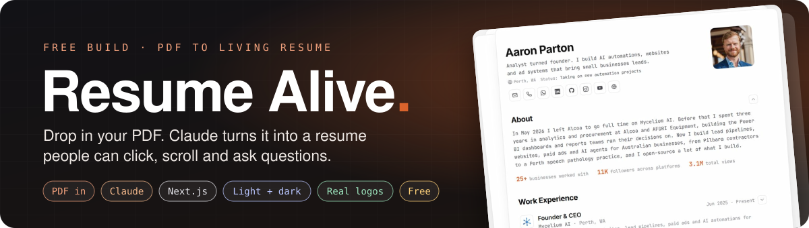
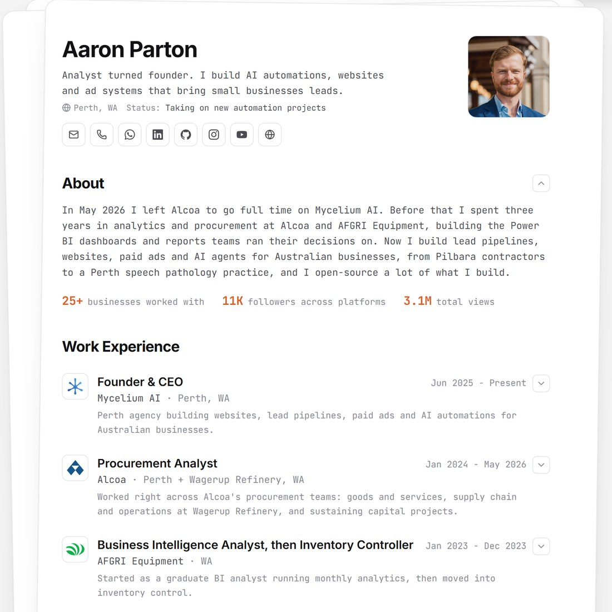
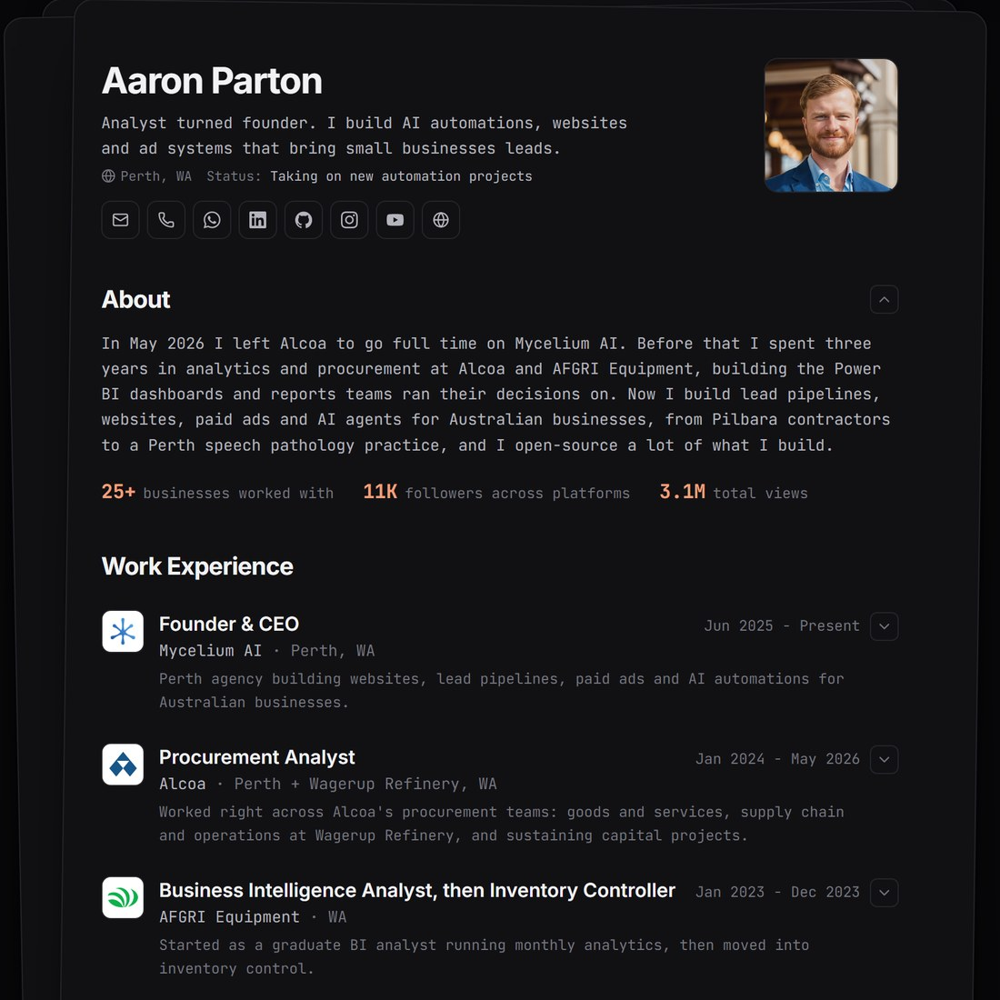
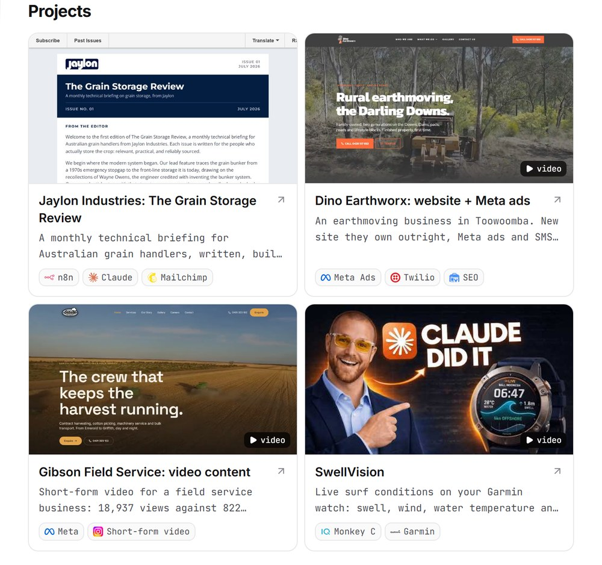
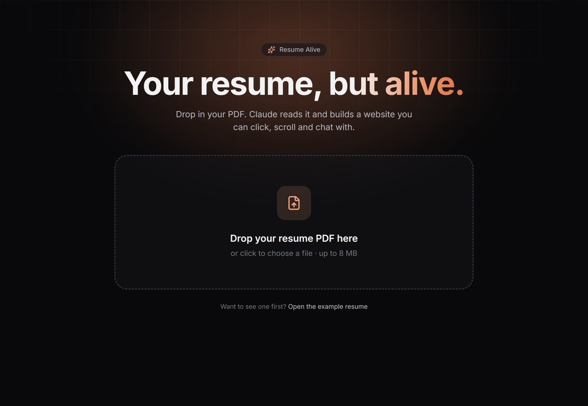

<p align="center">
  
</p>

<h3 align="center">Your resume, but alive. A PDF nobody remembers becomes a page they click through.</h3>

<p align="center">
  <a href="https://aaron-parton-resume.vercel.app"></a>
  &nbsp;
  <a href="https://vercel.com/new/clone?repository-url=https%3A%2F%2Fgithub.com%2Faaronparton2-sketch%2Fresume-alive&env=ANTHROPIC_API_KEY,BUILD_PASSCODE&envDescription=Claude%20API%20key%20for%20the%20PDF%20upload%20and%20chat.%20Passcode%20keeps%20strangers%20off%20your%20upload%20page.&envLink=https%3A%2F%2Fconsole.anthropic.com&project-name=my-resume&repository-name=my-resume"></a>
</p>
<p align="center"><sub>No coding. Your AI does the setup with you. Free to host on Vercel.</sub></p>

---

## 👋 New to GitHub? You only need one of these

**This page is just where Resume Alive lives.** You don't need to understand any of it. Pick a way in:

<table>
<tr>
<td width="50%" valign="top">

### ⚡ The fast way
Copy this and paste it into **[Claude](https://claude.ai)** or **[ChatGPT](https://chatgpt.com)**:

```text
Set this up for me: https://github.com/aaronparton2-sketch/resume-alive
```

It reads this page and walks you through it, one click at a time.

</td>
<td width="50%" valign="top">

### 🚀 The one-button way
1. Click **Deploy your own** above.
2. Sign in to Vercel with GitHub (free).
3. Paste your [Claude API key](https://console.anthropic.com) and pick a passcode.
4. Open `your-site.vercel.app/create` and drop in your PDF.

</td>
</tr>
</table>

---

## ✨ What it looks like

<table>
<tr>
<td width="50%"></td>
<td width="50%"></td>
</tr>
<tr>
<td align="center"><sub>☀️ Light mode</sub></td>
<td align="center"><sub>🌙 Dark mode (one click, remembered)</sub></td>
</tr>
</table>

It still reads like a resume: one sheet of paper, clean type. The detail hides in dropdowns until someone wants it.

---

## 🧩 What people can click

| | Feature | What it does |
|:-:|---|---|
| 📄 | **PDF in, website out** | Drop your resume at `/create`. Claude reads it and builds the whole page in about 15 seconds. |
| 🔽 | **Dropdowns** | Every job, school and answer opens to show the bullet points, skills, photos and video. |
| 🏢 | **Real company logos** | Each employer's logo is pulled from their own website automatically. No uploading. |
| 🧰 | **Tool logos** | Claude, n8n, Figma, Excel, Power BI and hundreds more show their real logo next to the name. |
| 🎬 | **Projects that move** | Hover a project: its video plays, or a long page scrolls top to bottom. |
| 🟩 | **Your GitHub, live** | The green-squares contribution graph and your total stars, updated hourly. |
| 📞 | **One-tap contact** | Email, call, WhatsApp, LinkedIn and the rest, each lighting up in its own brand colour. |
| 💬 | **Ask my resume** | Visitors ask questions and Claude answers, using only what's on your resume. |
| 🖨️ | **Save as PDF** | Prints a clean one-pager with every dropdown open, for the job portals that still want a file. |

<p align="center">
  
</p>

---

## 🪄 Make one from your PDF

<p align="center">
  
</p>

Drop the PDF in, then click **Open my site** to see it, or **resume.json** to keep it. Put that file in `data/resume.json` and redeploy, and your site is you.

---

## 🧠 How the clever bits work

| The problem | The answer |
|---|---|
| **A PDF is just a picture of text** | Claude reads the PDF and fills a strict template (`lib/schema.ts`), so the answer always fits the page. It's told to use only what's in the PDF and never invent a number. |
| **Resumes don't include logos** | Claude writes down each employer's website. `lib/logos.mjs` takes their app icon, favicon or header logo from that site, with Google's and DuckDuckGo's icon services as a backup. |
| **Tools don't come with icons either** | `lib/icons.mjs` looks each skill up in [svgl](https://svgl.app) and [Simple Icons](https://simpleicons.org), with light and dark versions so they show on both themes. |
| **GitHub has no "embed my graph" button** | `/api/github` reads your public contributions page and the GitHub API, and caches both for an hour. |
| **A public chat could run up a bill** | Short questions, short answers, and only the last 12 messages are sent. Each answer costs a fraction of a cent. |
| **Strangers could use your upload page** | Set `BUILD_PASSCODE` and `/create` asks for it before reading anything. |

---

## 🛠️ Make it yours

Everything lives in **`data/resume.json`**. Change it, save, and the page updates.

| Want to... | Do this |
|---|---|
| Add your photo | Put a square image in `public/` and set `"avatar": "/me.jpg"` |
| Add a video to a job or project | Add `{ "type": "youtube", "url": "https://youtube.com/watch?v=...", "caption": "Case study" }` to its `media` list. Also works: `video` (an .mp4), `image`, `link` |
| Make a long screenshot scroll on hover | Add `"hover": "scroll"` to that image |
| Fix a wrong logo | Change the job's `domain` (e.g. `"alcoa.com"`), or set `"logo": "/company.png"` |
| Save every logo locally | `npm run logos` then `npm run icons` |
| Show your GitHub graph | Set `"github": "your-username"` |
| Let people download your PDF | Put it in `public/` and set `"resumePdf": "/resume.pdf"` |
| Change the accent colour | Edit `--accent` at the top of `app/globals.css` |

Every section hides itself when it's empty, so you only show what you've got.

<details>
<summary><b>Run it on your own computer</b></summary>
<br>

You need [Node.js](https://nodejs.org) 20 or newer.

```bash
npm install
cp .env.example .env.local   # paste your Claude key into ANTHROPIC_API_KEY
npm run dev                  # then open http://localhost:3000/create
```

| Page | What it is |
|---|---|
| `/` | Your resume, from `data/resume.json` |
| `/create` | Drop a PDF, get a resume |
| `/preview` | The one you just made (kept in your browser only) |
| `/example` | A made-up person with every section filled in |

</details>

<details>
<summary><b>What does it cost?</b></summary>
<br>

Hosting on Vercel's free plan: $0. Reading one resume with Claude: a few cents. Each chat answer: a fraction of a cent. You pay Anthropic directly with your own key.

</details>

---

<p align="center">
  Built by <a href="https://www.instagram.com/aaronautomates/"><b>@aaronautomates</b></a> · Next.js, Tailwind, Motion and the Claude API · MIT licence
</p>
